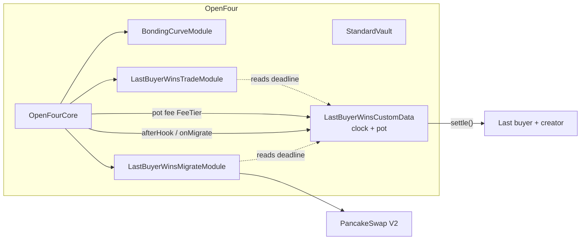

# Last Buyer Wins

**Last Buyer Wins** is an OpenFour bonding preset with a countdown and an on-chain prize pot.
Every qualifying buy makes the buyer the current last buyer and adds time to the clock. A pot fee
on every trade accumulates in the token's custom-data module. When the clock hits zero, or the curve
sells out, the token graduates to PancakeSwap V2 and the last buyer can be paid the pot.

`presetId = TBD (assigned by OpenFour governance)`

---

## 1. Architecture



| Slot | Key / tag |
| --- | --- |
| Token | `module.token.standard` (reused) |
| Vault | `module.vault.standard` (reused) |
| Curve | `module.curve.bonding` (reused) |
| Trade | `module.trade.last_buyer_wins` |
| Migrate | `module.migrate.last_buyer_wins` |
| Custom data | `module.data.last_buyer_wins` |

## 2. Lifecycle

```text
Create   → clock = initialDuration; hardDeadline = now + maxGameDuration
Trading  → qualifying buy: lastBuyer = buyer; deadline = min(deadline + extension, now + maxRemaining, hardDeadline)
           every trade pays buy/sell pot fee into the pot
Zero     → buys capped at postRoundMaxBuy; first buy triggers migration; never counts
Sold out → migration closes the round at that moment
Settle   → anyone calls settle(): winnerBps to lastBuyer, rest to creator (no buyer → all to creator)
Sweep    → settle() again pays out fees that arrived after the round ended
```

## 3. Parameters

### customDataParams — `abi.encode(LastBuyerWinsCustomData.Params)`

| Field | Type | Default | Bounds |
| --- | --- | --- | --- |
| `initialDuration` | uint256 s | 3600 | ≥ 300, ≤ maxGameDuration |
| `extensionPerBuy` | uint256 s | 60 | 1 to 86400 |
| `maxRemaining` | uint256 s | 3600 | ≥ initialDuration, ≤ maxGameDuration |
| `maxGameDuration` | uint256 s | 604800 | ≤ 30 days |
| `minQualifyingQuote` | uint256 wei | 0.01 ether | ≤ raiseAmount / 10 (validator) |
| `winnerBps` | uint16 | 9000 | 5000 to 10000 |

### tradeParams — `abi.encode(LastBuyerWinsTradeModule.TradeConfig)`

| Field | Type | Default | Bounds |
| --- | --- | --- | --- |
| `buyPotFeeBps` | uint16 | 100 | ≤ 1000 |
| `sellPotFeeBps` | uint16 | 200 | ≤ 1000, at least one fee > 0 |
| `maxBuyAmount` | uint256 | 0 (unlimited) | ≤ saleAmount |
| `postRoundMaxBuy` | uint256 | 1e18 | > 0, ≤ saleAmount |

### migrateParams — `abi.encode(LastBuyerWinsMigrateModule.Params)`

| Field | Type | Notes |
| --- | --- | --- |
| `migrationAdapter` | address | PCS V2 adapter; 0x0 skips liquidity |
| `lpRecipient` | address | `0x…dEaD` burns LP |
| `tokenLiquidityAmount` | uint256 | ≤ maxSupply − saleAmount |
| `maxQuoteToUse` | uint256 | 0 = all raised |

## 4. Detection

| Method | Match |
| --- | --- |
| `presetId` | `TokenCreated.presetId == <assigned>` |
| custom data tag | `descriptor().tag == "module.data.last_buyer_wins"` on `TokenCreated.customData` |

## 5. Frontend / bot integration

Read everything in one call:

```solidity
LastBuyerWinsCustomData(customData).gameState()
// deadline, hardDeadline, timeLeft, ended, migrated, lastBuyer, qualifyingBuys,
// minQualifyingQuote, extensionPerBuy, winnerBps, potNative, potErc20, potErc20Amount
```

Events:

| Event | When |
| --- | --- |
| `LastBuyerUpdated(buyer, curveQuote, newDeadline, qualifyingBuys)` | every counting buy |
| `RoundClosedByMigration(timestamp, winner)` | sell-out migration |
| `PotSettled(asset, winner, winnerAmount, creator, creatorAmount)` | each payout |

UI guidance:
- Show the live clock from `deadline` and the pot from `gameState()`.
- Warn when a buy's curve quote is below `minQualifyingQuote`: it trades but does not take the lead.
- After zero, label buys as "graduate the token" and show `settle()` as a public button.
- Use `LastBuyerWinsMigrateModule.canMigrateNow()` to show graduation readiness.

## 6. Quote assets

Pot fees may arrive as native BNB, wrapped native, or the quote ERC20. `settle()` pays out all three.
If a winner cannot receive native, it is paid in wrapped native instead.
